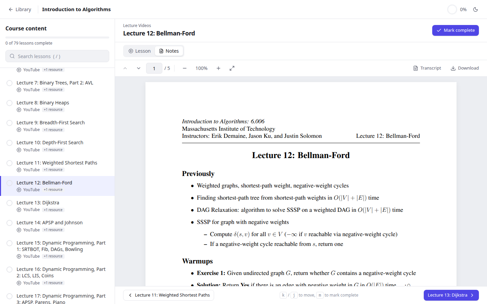
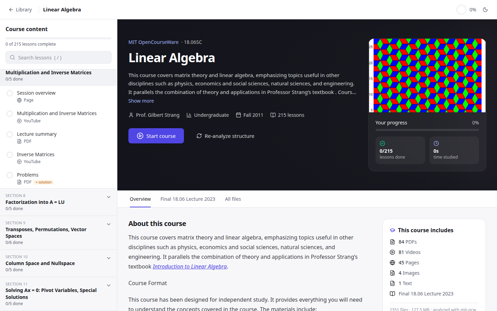
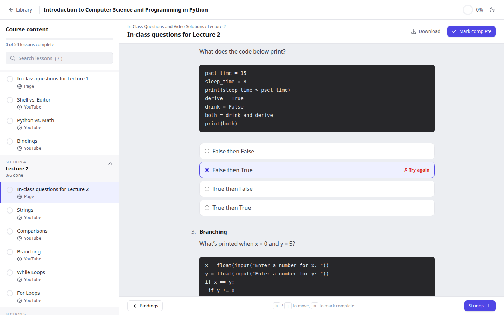
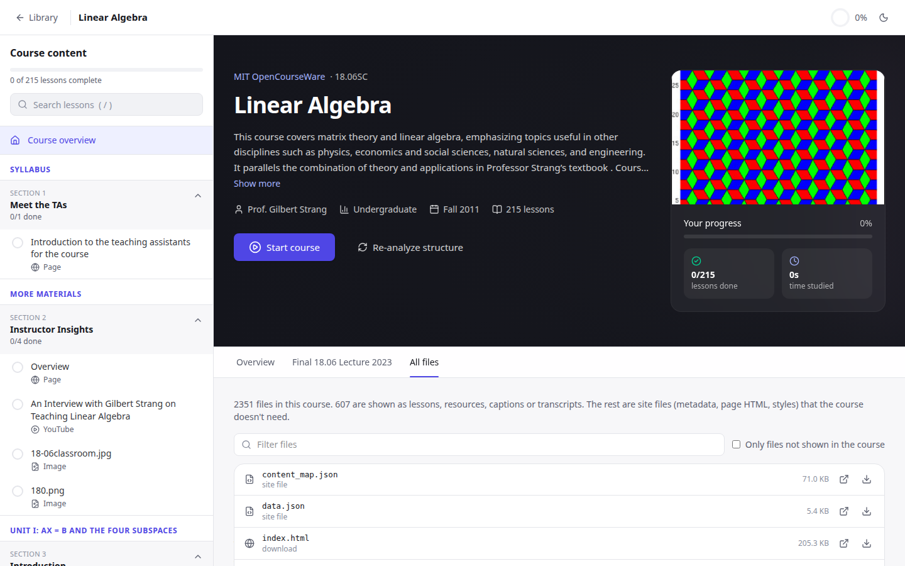
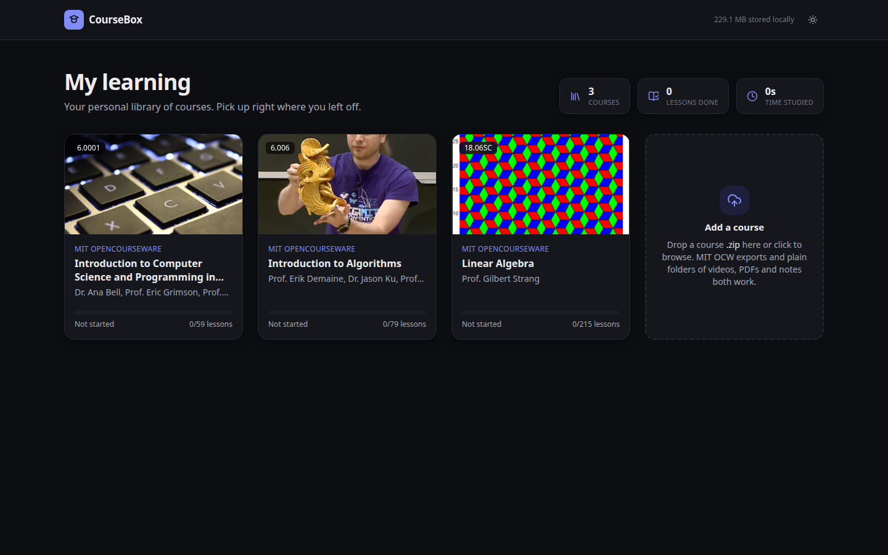

# CourseBox

**Turn a downloaded course zip into your own Coursera/Udemy-style learning space.**
Drop in an MIT OpenCourseWare export, a Udemy-style download or any folder of videos, PDFs and notes.
CourseBox works out the structure (units, sessions, lectures, problem sets with solutions) and gives you a
clean course player with progress tracking. Reading needs no account. Everything works in your browser. If you
create a free account, your courses (up to 2 at a time) and progress are saved, so you never re-upload and you can
continue on any device.



## Features

- **Drag and drop a zip.** It's unzipped in a Web Worker and stored in IndexedDB. No server, no account.
- **Smart structure detection:**
  - **MIT OCW:** units → sessions (18.06SC style), lecture videos with their notes attached, captions
    and transcripts linked to videos, problem sets and exams paired with locked solutions and starter
    templates, in-class multiple-choice questions you can answer, and syllabus/calendar as tabs.
  - **Any folder:** numbered sections and lessons, Udemy `1.1 resource` files, one-folder-per-lesson
    layouts, subtitles as captions, README as the course overview, and website/tooling junk ignored.
  - **Nothing is lost:** files no rule recognizes land in *Additional Materials*, and the
    **All files** tab shows where every file went.
- **Viewers:** PDF (page nav, zoom, resumes where you left off), video/audio (speed, captions, resume),
  YouTube with an MP4 fallback, Markdown, sanitized HTML, code, Jupyter notebooks, images, and zips
  you can browse inside the app.
- **Learning flow:** sidebar with progress, "Continue where you left off", mark complete,
  study time (counted only while the tab is visible), `j`/`k`/`m`/`/` shortcuts, dark mode, mobile drawer.
- **Re-analyze** a course or **re-import a newer version** without losing progress.
- **Optional accounts** (email or username + password): courses saved to S3 through presigned URLs, progress
  synced across devices, and 2 courses per account (delete a finished one to add another). See [server/](server/README.md).

| Units and sessions (MIT 18.06SC) | In-class questions (MIT 6.0001) |
| --- | --- |
|  |  |
| **Every file accounted for** | **Library** |
|  |  |

## Quick start

```bash
git clone https://github.com/Yab112/coursebox && cd coursebox
npm install
npm run dev     # open http://localhost:3000 (landing page) or /library, and drop a course zip
```

Requires Node 20+. To get an MIT course, open it on [ocw.mit.edu](https://ocw.mit.edu) and choose
**Download course**.

## Accounts & backend (optional)

```bash
cd server && cp .env.example .env && npm install && npm run dev   # API on :4000 (local disk storage)
```

The web app talks to `NEXT_PUBLIC_API_URL` (default `http://localhost:4000`). Deploying it with S3 and
Supabase on Render and Vercel is covered step by step in [docs/DEPLOY.md](docs/DEPLOY.md).

## Scripts

| Command | What it does |
| --- | --- |
| `npm run dev` / `npm run build && npm start` | Run the app |
| `npm test` | Unit tests for the analyzers (Vitest, real OCW metadata fixtures) |
| `npm run test:e2e` | End-to-end tests (Playwright) incl. accounts; starts a test API + Postgres in Docker. `PW_CHANNEL=chrome` uses an installed Chrome |
| `cd server && npm test` | API tests against a real Postgres 17 (Docker) |
| `npm run analyze -- course.zip` | Print the structure CourseBox detects for a zip or folder |

## How it works

```
zip ──► Web Worker (JSZip) ──► IndexedDB files ──► analyzers ──► CourseManifest ──► course player
                                                     │
                       ocw.ts → generic.ts → coverage safety net (Additional Materials)
```

- `lib/analyzers/`: pluggable adapters. The first whose `detect()` matches builds a `CourseManifest`
  (sections → lessons, with attachments and solutions).
- `lib/db.ts`: Dexie tables for courses, files, progress, last-opened state and daily study time.
  Progress is keyed by file **path**, so re-analysis and updates keep it.
- `components/viewers/`: one viewer per file type.
- `app/page.tsx` + `components/landing/`: the landing page. The library lives at `/library`.
- `lib/xray.ts` + `lib/xray.worker.ts`: the landing page's X-ray. It runs the real analyzers on a dropped zip
  in a worker, without storing anything, and shows where every file goes. The sample in `public/samples/` is
  built from the 6.006 fixture by `npx tsx scripts/build-xray-sample.mts` (re-run it after analyzer changes).
- Code files and notebooks can be edited (your copy, in IndexedDB `edits`; originals untouched) and Python runs in the
  browser: `public/python-worker.mjs` (a module worker, as Pyodide requires) + `lib/python.ts`. The Pyodide runtime is
  copied to `public/pyodide` on install; packages like numpy load from Pyodide's CDN on first import
  (`NEXT_PUBLIC_PYODIDE_PACKAGES` overrides it).
- `/status` (`components/status/`) reads the API's public `GET /status`: live database, storage and email checks,
  response-time history, region and commit, plus the roadmap from `lib/features.ts`.
- `lib/features.ts`: the feature registry the landing page renders. Upcoming features (catalog, AI recaps,
  short notes, quizzes, highlights) are marked `soon` and listed under "Next term"; flip one to `live` when it
  ships and it moves into the syllabus list.

See [CONTRIBUTING.md](CONTRIBUTING.md) to teach CourseBox a new course layout.

## Deploy

It's a standard Next.js app: import the repo on Vercel (or run `npx vercel`). Courses live in each
visitor's own browser, so a deployed copy is still private to whoever uses it.

## Roadmap

- Notes and highlights pinned to PDF pages, with markdown export
- Study heatmap, streaks and weekly goals
- "Ask about this lesson" with an LLM

## License

MIT for the code. The test fixtures contain MIT OpenCourseWare metadata under CC BY-NC-SA 4.0
(see [tests/fixtures/NOTICE.md](tests/fixtures/NOTICE.md)). CourseBox is not affiliated with MIT.
